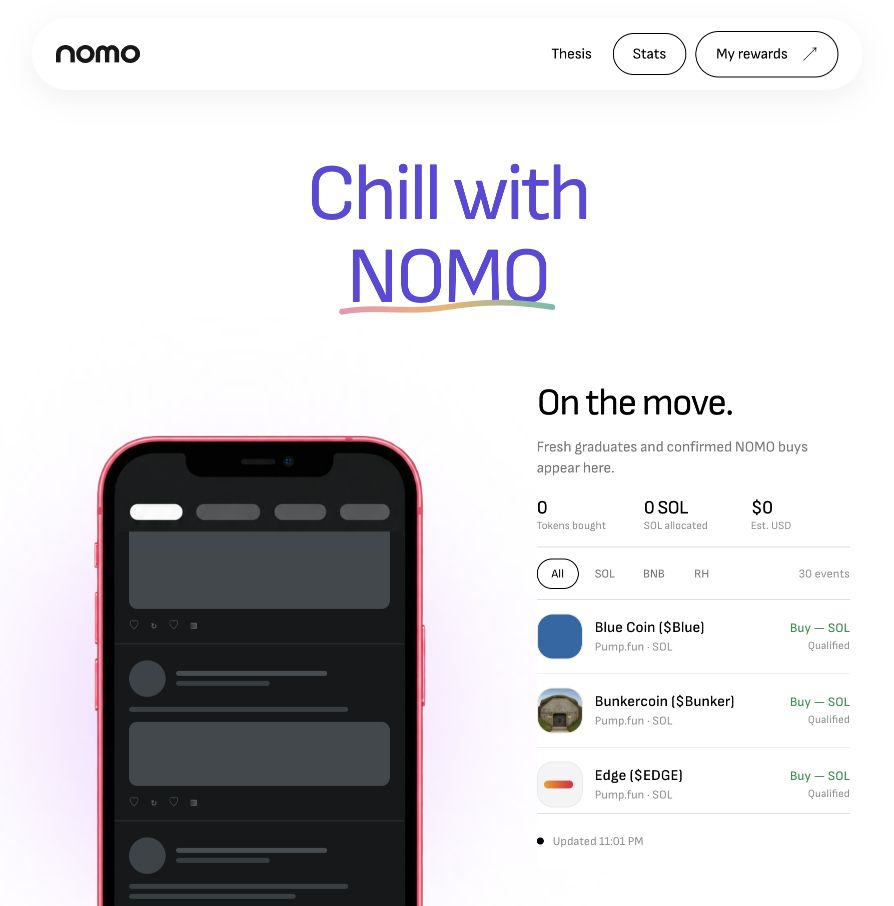

<p align="center">
  
</p>

<h1 align="center">Chill with NOMO.</h1>

<p align="center">
  A holder rewards engine for newly graduated tokens on Solana, BNB Chain and Robinhood Chain.
</p>

<p align="center">
  <a href="https://nomosol.tech/">Live website</a> ·
  <a href="https://x.com/nomotechsol">X / Twitter</a> ·
  <a href="docs/ARCHITECTURE.md">Architecture</a> ·
  <a href="docs/OPERATIONS.md">Operations guide</a>
</p>

<p align="center">
  
</p>

## The idea

Scroll your feed. NOMO watches for new graduates. When an eligible token migrates, the backend can use a quarter of the **current** treasury balance to buy it and allocate the purchased tokens to NOMO holders.

```text
  NOMO / PUMP trading
          |
          v
  creator fees in PUMP --claim--> PUMP --swap--> SOL treasury
                                                 |
             qualified new graduation -----------+
                                                 |
                               25% of current SOL balance (min 1 SOL)
                                                 |
                              +------------------+------------------+
                              |                  |                  |
                           Solana             BNB Chain      Robinhood Chain
                              |                  |                  |
                              +------------------+------------------+
                                                 |
                                         purchased token
                                                 |
                                  +--------------+--------------+
                                  |                             |
                           70% holder pool               30% treasury
```

The other token's GMGN **Total Fees** is an eligibility filter. It is separate from NOMO's own creator fees, which fund purchases. The backend claims NOMO fees before processing an eligible graduation; there is currently no independent periodic fee-claim job.

## How a round works

1. Discover a migration and verify the launchpad event and pool on chain.
2. Require fresh GMGN Total Fees and apply the configured filters. Mayhem Mode is excluded on Pump.fun.
3. Claim NOMO creator fees from its PUMP-quoted curve and PumpSwap pool; swap collected PUMP to SOL without Jupiter.
4. Reserve 25% of the treasury's available SOL balance. If that budget is below **1 SOL**, skip this graduation without bridging or buying. Otherwise bridge to BNB or Robinhood Chain when needed, leaving native gas reserves.
5. Take a finalized snapshot of NOMO holders at the purchase. Wallets need at least **1,000,000 NOMO**; known bonding-curve and liquidity-pool accounts are excluded.
6. Buy the graduated token through a validated route. The pair may be quoted in another asset if a liquid route exists.
7. Keep 30% of the tokens in the treasury and allocate 70% to eligible holders, proportional to their snapshot balances.

New Solana rewards are sent automatically to holder wallets. BNB and Robinhood Chain rewards use an EVM wallet linked by signatures; holders claim from the website and pay the network fee. All allocations are recorded in SQLite with transaction recovery state.

| Network | Launchpads | Holder delivery |
| :-- | :-- | :-- |
| Solana | Pump.fun, StonkFun | Automatic SPL transfers |
| BNB Chain | Flap tax / non-tax, Four.meme | Linked EVM wallet + claim |
| Robinhood Chain | Pons V2 | Linked EVM wallet + claim |

The default Total Fees floors are 1 SOL, 0.15 BNB and 0.042934 ETH respectively. Other risk filters are configurable in [`config/filters.example.json`](config/filters.example.json). Routes and liquidity can change between discovery and execution; no token or pair is guaranteed to be buyable. The current purchase slippage setting is 99%.

## Run locally

Requires Node.js 24 and npm.

```bash
npm ci
cp .env.example .env
# Configure your own RPC endpoints and GMGN key in .env.
npm run build
npm test
npm run web:build
npm run dev
```

The API runs on `127.0.0.1:8789` by default. In another terminal, `npm run web:dev` starts the frontend dev server. Keep `LIVE_TRADING=false`, `LIVE_BSC_TRADING=false` and `LIVE_RH_TRADING=false` while exploring the project. The local `.env`, databases, key files, build output and simulation artifacts are excluded from Git.

## Verification and launch boundary

The project has unit and local integration tests for candidate filtering, sequential 25% budgeting, allocation math, recovery, wallet linking and payouts. Historical purchase routes were also checked on local Solana forks or through read-only EVM simulation. These checks are **not** proof of a full funded NOMO round: NOMO has no mint or PUMP pool yet, so its real creator-fee claim and PUMP-to-SOL conversion have not run end to end. Mainnet trading must stay disabled until the mint, creator wallet, separate reward wallets and a small funded round are verified.

Backend signing keys belong in private files outside the repository, referenced by paths in `.env`. Never commit a seed phrase, keypair, API token, `.env` file or production database.

See the [architecture](docs/ARCHITECTURE.md) for execution details and the [operations guide](docs/OPERATIONS.md) for setup and local smoke tests.
